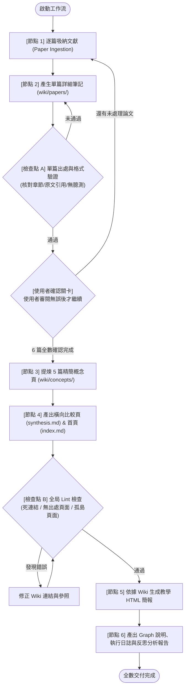

# AGENTS.md — LLM Wiki 維護規範與代理人工作指南

本文件定義此 LLM Wiki 知識庫的架構規範、代理人（AI Agent）工作流程、驗證準則與下游產出（教學 HTML 簡報）要求。任何參與本知識庫建立、維護與擴充之 AI 代理人均必須嚴格遵循本指南。

---

## 1. 專案總覽與核心目標

- **主題**：社交機器人的設計與應用（Design and Application of Social Robots）
- **核心資料來源**：`raw/` 資料夾內 6 篇人機互動（HRI/Robotics）頂尖論文（`paper1.pdf` ~ `paper6.pdf`）。
- **主要目的**：個人學習筆記、課程報告準備，並作為下一步產出**「教學型 HTML 簡報」**的唯一權威知識庫。
- **最終交付標準**：
  1. 結構嚴謹且相互連結的 Markdown Wiki 知識庫。
  2. 一份可原生瀏覽、面向初學者的教學型 HTML 簡報（內容嚴格由 Wiki 提煉）。
  3. 完整的 Loop / Graph 流程圖、執行記錄、Lint 檢查報告與反思分析。

---

## 2. 目錄架構與檔案命名規範

```text
my-wiki/
├── AGENTS.md                  # 本文件（Wiki 規範與 Agent 操作手冊）
├── raw/                       # [唯讀] 原始 6 篇論文 PDF，嚴禁修改或刪除
└── wiki/                      # Wiki 知識庫核心目錄
    ├── index.md               # 首頁：知識地圖、導讀與目錄索引
    ├── synthesis.md           # 橫向比較頁：跨篇比較矩陣、設計空間與報告建議
    ├── log.md                 # 操作紀錄：記錄每次 Ingest / Lint / 修改歷程
    ├── lint-report.md         # Lint 結果：記錄每次檢查日期、問題與修正動作
    ├── papers/                # 單篇論文摘要頁（共 6 篇）
    │   ├── paper1-dialogue-authoring.md
    │   ├── paper2-campus-guide.md
    │   ├── paper3-campus-robot-trust.md
    │   ├── paper4-joint-dialog-navigation.md
    │   ├── paper5-narrative-remote-guide.md
    │   └── paper6-codesign-newcomer-learning.md
    └── concepts/              # 核心主題概念頁（精簡版，共 5 篇）
        ├── dialogue-interaction.md
        ├── navigation-co-navigation.md
        ├── trust-transparency.md
        ├── robot-roles.md
        └── application-domains.md
```

- **檔案命名**：一律使用英文小寫與連字號（`kebab-case`），禁止在檔名中使用中文或特殊字元。
- **檔案路徑引用**：一律採用標準 Markdown 相對路徑（例如 [Paper 1](../papers/paper1-dialogue-authoring.md)）。
- **操作紀錄（`wiki/log.md`）規範**：每次執行 Ingest、Lint 或重大內容修改時，均須在檔案末尾追加一筆紀錄，格式為：
  `日期 | 操作 | 影響檔案 | 備註`（例如：`2026-11-22 | Ingest | wiki/papers/paper1-*.md, wiki/index.md, wiki/log.md | 完成 Paper 1 摘要與索引更新`）。

---

## 3. 核心規範與寫作準則

### 3.1 原始資料唯讀原則
- `raw/` 目錄下的原始檔案（`paper1.pdf` 至 `paper6.pdf`）為**唯讀資料來源**。
- 嚴禁重命名、修改、搬移或刪除 `raw/` 內部的任何檔案。

### 3.2 語言與名詞規範
- 全文以**繁體中文（台灣習慣用語）**撰寫。
- 專有名詞與專業術語**保留英文原文**或在首次提及時提供中英對照（例如：HRI, Socially Assistive Robots (SAR), SLAM, Co-Navigation, Deep Recurrent Reinforcement Learning (DRRL), Telepresence, POMDP, Costmap 等）。

### 3.3 出處與事實忠實性原則（Source Grounding）
- **精確出處標註**：每個事實性論點、數據或結論，均須明確標註論文名稱與章節（例如：`[paper2.pdf, Section 4 SPEECH MODULE]`）。
- **嚴禁臆測章節**：若 PDF 中無明確節次標題或頁碼不易確定，**必須如實標註「章節未確認」，嚴格禁止自行編造章節號**。
- **關鍵結論附帶原文短句**：重要量化數據、核心主張或關鍵受試者回饋，必須附上簡短的英文原文引用（Short Quote），確保有據可查。
- **爭議與矛盾處理**：若不同論文在觀點上有衝突（例如遠端參觀時是否應顯示操作者面孔、機器人應主導或輔助引導），**必須完整並列雙方觀點、實驗情境與研究限制，嚴禁代理人自行裁決**。

### 3.4 概念頁精簡版原則
- 為了控制工作量並確保重點聚焦，每篇概念頁篇幅控制在 **300–500 字**。
- 內容以「核心概念定義」、「跨論文觀點整合」、「關鍵文獻對照」為主，優先確保出處與事實正確，不堆砌冗長描述。

### 3.5 文獻吸納規則（Ingest Rules）
- **知識來源封閉**：撰寫時只能使用 `raw/` 內該篇 PDF 的內容，不得擅自加入該篇 PDF 以外的未驗證背景知識。
- **連鎖同步更新**：每次完成單篇論文 Ingest 後，必須同步更新 `wiki/index.md`（加入該篇摘要與索引）與 `wiki/log.md`（追加操作紀錄），並在相關的「核心主題概念頁（`wiki/concepts/`）」補上該篇的具體論點與參照連結。

---

## 4. 下游應用：教學型 HTML 簡報製作規則

Wiki 建立後的直接下游任務為生成一份教學型 HTML 簡報，代理人必須遵守以下限制：
1. **知識封閉性**：簡報的內容**只能使用 Wiki（`wiki/` 內文件）記載的資訊**，不得脫離 Wiki 知識庫隨意添加未經 Wiki 整理的事實。
2. **出處回溯性**：簡報中的每一張投影片（Slide），頁尾必須清楚標註該頁內容對應的 **Wiki 出處頁面與段落**（例如：`來源：wiki/concepts/trust-transparency.md`）。
3. **教學導向**：簡報架構需循序漸進，讓原本不熟悉社交機器人的初學者能快速理解「是什麼、如何設計、面臨哪些挑戰與未來展望」。

---

## 5. 代理人工作流與 Loop / Graph 設計

整體建置流程分為四個階段、六大執行節點與兩大關鍵檢查機制：



### 檢查點定義（Checkpoint Definitions）
- **檢查點 A（單篇出處與格式驗證）**：在單篇論文筆記生成後立即執行，嚴格核對出處章節標註、關鍵結論原文短句（Short Quote）、禁止臆測無標籤章節，並確認符合 6.1 模板規格。
- **檢查點 B（全局 Lint 檢查）**：在所有論文、概念頁與綜合頁生成完畢後執行，全面檢查死連結（Broken Links）、無出處頁面（Ungrounded Claims）與孤島頁面（Orphan Pages），若發現問題則進入修正迴圈直至全數通過。

### 5.1 關鍵執行節奏（Execution Cadence）
- 預設一次處理一篇，完成後等使用者確認。使用者明確指示可批次處理時，得連續處理多篇，但每篇仍須通過檢查點 A。

### 5.2 Lint 檢查機制與報告規範（Lint Rules & Reporting）
在進入全局綜合與簡報產出前，必須執行三大項 Lint 檢查：
1. **死連結檢查（Broken Link Linting）**：遍歷所有 Markdown 相對路徑與標題錨點，確認沒有無效連結。
2. **無出處頁面檢查（Ungrounded Claim Linting）**：檢查每篇文章的論點是否均包含合規的論文出處標註。
3. **孤立頁面檢查（Orphan Page Linting）**：檢查是否存在任何沒有被 `index.md`、`synthesis.md` 或其他頁面引用的檔案。

- **寫入規範**：每次 Lint 的結果要寫入 `wiki/lint-report.md`，包含檢查日期、發現的問題、修正動作。
- **排除範圍**：Lint 檢查對象為 `wiki/` 目錄下的知識庫內容文件，排除 `AGENTS.md` 規範手冊中的示範語法與模板範例連結。

---

## 6. 標準 Markdown 模板規格

### 6.1 單篇論文摘要頁模板（`wiki/papers/paperX-*.md`）
```markdown
---
title: "論文標題"
type: paper
paper_id: paperX
venue: "會議/期刊名稱 年份"
authors: "作者名單"
tags: [社交機器人, HRI, ...]
date: 2026-11-21
---

# 論文標題

- **出處資訊**：發表於 [會議/期刊]，[作者]，[年份]
- **原始檔案**：`raw/paperX.pdf`

## 1. 核心摘要 (TL;DR)
[1-3 句話精簡說明核心貢獻與價值]

## 2. 研究背景與痛點 (Problem Statement)
[欲解決的核心問題，標註出處章節]

## 3. 系統架構與技術方法 (Methodology & Architecture)
[硬體、軟體模組、演算法，標註出處章節]

## 4. 使用者研究與實驗設計 (User Study & Evaluation)
[受試者規模、實驗場景、評估指標，標註出處章節，重要數據附原文短句]

## 5. 主要發現與研究限制 (Key Findings & Limitations)
[質化/量化結果，矛盾與限制，標註出處章節]

## 6. 課堂報告亮點與啟發 (Takeaways for Presentation)
[適合報告強調的核心觀念與展示重點]

## 7. 相關概念雙向連結 (Related Concepts)
- [對話互動](../concepts/dialogue-interaction.md)
- [信任度與透明性](../concepts/trust-transparency.md)
```

### 6.2 概念頁精簡版模板（`wiki/concepts/*.md`）
```markdown
---
title: "概念名稱"
type: concept
tags: [概念, ...]
sources: [paper1, paper2, ...]
date: 2026-11-21
---

# 概念名稱

## 1. 核心定義與在社交機器人中的重要性
[約 100-150 字說明該概念的意涵]

## 2. 各論文觀點與技術作法比較
[約 150-250 字，精簡對比不同論文的取向，每項論點明確標註論文名稱與章節]

## 3. 設計權衡與開放挑戰 (Trade-offs & Challenges)
[約 100 字，總結設計時面臨的矛盾或技術瓶頸]

## 4. 參考文獻對照 (References)
- [論文標題 1](../papers/paper1-dialogue-authoring.md) - 章節與關鍵短句
- [論文標題 2](../papers/paper2-campus-guide.md) - 章節與關鍵短句
```
