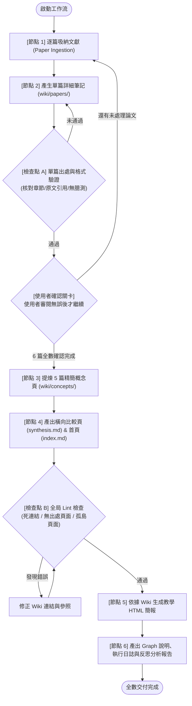

# LLM Wiki 工作流說明、執行紀錄與反思分析

> **注意**：本文件嚴格依據 `wiki/log.md` 與 `wiki/lint-report.md` 的真實紀錄撰寫。
> 所有 git commit hash 均可在本儲存庫的 `git log` 中查驗。
> 未在上述檔案中出現的事件，本文件不加以陳述。

---

## 1. Loop／Graph 設計說明

### 1.1 整體架構

本知識庫的建置流程依據 `AGENTS.md` 第 5 節設計，分為**四個階段、六大執行節點**與**兩大關鍵檢查機制**，形成一個帶有修正迴圈（Loop）的有向圖（Graph）：

### 1.2 各節點與機制說明

| 編號 | 節點／機制 | 職責說明 |
|---|---|---|
| **節點 1** | Paper Ingestion（逐篇吸納） | 讀取 `raw/paperX.pdf` 原始內容，提取章節標題、關鍵數字、受試者資料與作者主張 |
| **節點 2** | Paper Note Generation（單篇筆記） | 依 `AGENTS.md` 第 6.1 節模板產出 `wiki/papers/paperX-*.md`，要求每項論點標明章節、具體數字附原文短句、推測明確標記 |
| **檢查點 A** | 單篇出處與格式驗證 | 核對章節標題是否為 PDF 實際標題（非臆測）、數字是否附原文短句、推測是否有 "We suspect / plan to" 等明確詞語、第 6 節是否標明為整理者詮釋 |
| **使用者確認關卡** | Human-in-the-Loop 審閱 | 使用者對照 PDF 人工審閱，確認無誤後方可繼續下一篇 |
| **節點 3** | Concept Page Generation（概念頁提煉） | 依 `AGENTS.md` 第 6.2 節模板提煉 5 篇跨篇概念頁（300–500 字），整合多篇論文觀點，衝突觀點並列呈現 |
| **節點 4** | Synthesis & Index（橫向比較與首頁） | 建立 `wiki/synthesis.md`（6 篇比較矩陣、設計空間圖、課堂講綱）與 `wiki/index.md`（初學者閱讀路徑、全頁面索引） |
| **檢查點 B** | 全局 Lint 檢查 | 三項自動化掃描：死連結、孤立頁面、無出處頁面；發現問題則進入修正迴圈 |
| **節點 5** | Slide Generation（HTML 簡報生成） | 依 `AGENTS.md` 第 4 節規範，嚴格從 `wiki/` 提煉內容，每張投影片頁尾標明 wiki 出處 |
| **節點 6** | Doc Generation（工作流說明文件） | 產出本文件（`docs/process.md`），包含流程圖說明、實際執行紀錄、檢查點記錄與反思 |

### 1.3 兩大迴圈結構

1. **單篇修正迴圈**（節點 2 ↔ 檢查點 A）：每篇論文筆記生成後立即自查，不合規則退回重寫，直至通過後才進入使用者確認關卡。
2. **全局修正迴圈**（節點 4 ↔ 檢查點 B ↔ FixWiki）：綜合頁完成後執行全局 Lint；若存在死連結或孤立頁面則修正後重跑，直至全數通過。

---

## 2. 實際執行紀錄

以下依 `wiki/log.md` 紀錄與 `git log` commit 順序呈現，各事件均有對應的 commit hash 可查驗。

### 階段一：規範建立（2026-11-21 至 2026-11-22）

| 日期 | 操作 | 對應 Commit | 內容摘要 |
|---|---|---|---|
| 2026-11-21 | Init | `c2b3799` | 加入 6 篇原始 PDF（`raw/paper1.pdf` ~ `raw/paper6.pdf`），建立儲存庫 |
| 2026-11-22 19:34 | Config → `a2d627a` | `a2d627a` | 完成 `AGENTS.md` 規範文件，含 Mermaid 工作流圖、檢查點定義、模板（6.1 / 6.2）、Ingest/Lint 規則 |
| 2026-11-22 19:34 | Config | — | 後續調整：新增 `wiki/log.md`、`wiki/lint-report.md`、目錄架構、5.1 批次彈性規則 |

### 階段二：逐篇文獻吸納與人工審閱（節點 1–2 + 檢查點 A）

| 日期 | 論文 | 對應 Commit | 節點 2 產出 | 檢查點 A 狀態 |
|---|---|---|---|---|
| 2026-11-22 19:47 | Paper 1 | `1f2eff2` | `wiki/papers/paper1-dialogue-authoring.md`；初次更新 `wiki/index.md`、3 篇概念頁初稿、`wiki/lint-report.md`、`wiki/log.md` | ⚠️ **未通過→修正（見 3.1 節）** |
| 2026-11-22 20:24 | Papers 2–6 | `aad7859` | `wiki/papers/paper2-*.md` ~ `paper6-*.md`；更新 `wiki/index.md`；補充所有 5 篇概念頁；追加 `wiki/lint-report.md` 檢查點 A 紀錄（Papers 2–6 均通過）；補充深度數字核對表（Paper 2–6 共 42 筆數字 ✅） | ✅ **通過**（Paper 2–6） |

> **說明**：Paper 2 至 Paper 6 的 Ingest 與人工審閱（使用者確認關卡）在同一 commit `aad7859` 中完成，此為使用者明確授權批次處理（符合 `AGENTS.md` 第 5.1 節規範）。Paper 1 的修正另見 3.1 節。

### 階段三：概念頁提煉與綜合頁建立（節點 3–4）

| 日期 | 操作 | 對應 Commit | 內容摘要 |
|---|---|---|---|
| 2026-11-22 20:32 | Synthesize (Concepts) | `b501a67` | 依 `AGENTS.md` 第 6.2 節重構 5 篇核心概念頁（各篇 300–500 字，含出處章節、原文短句、衝突觀點並列與推測/實證區分） |
| 2026-11-22 20:32 | Synthesize & Index | `b501a67` | 建立 `wiki/synthesis.md`（6 篇論文比較矩陣，每格附出處；Mermaid 設計空間圖；三幕式報告講綱）；更新 `wiki/index.md`（加入初學者閱讀路徑與全頁面相對路徑連結） |

### 階段四：全局 Lint、術語精修與下游產出（節點 5–6）

| 日期 | 操作 | 對應 Commit | 內容摘要 |
|---|---|---|---|
| 2026-11-22 20:32 | Lint (Checkpoint B) | `b501a67` | 執行全局三項 Lint 掃描（見 3.2 節） |
| 2026-11-22 20:43 | Refine & Lint Doc | `70a130d` | 術語精修（Paper 2 / 3 / 4 / 6 以及 synthesis.md）；澄清 Paper 4 之 95% 數字；於 `lint-report.md` 新增「Lint 的限制」節；更新 AGENTS.md 5.2 排除規則 |
| 2026-11-22 20:50 | Slide Gen | `6e00785` | 生成 `slides.html`（24 張投影片，零外部依賴，含鍵盤導覽、頁碼、頁尾出處標註） |
| 2026-11-22 20:51 | Doc Gen | （本次操作，待 commit） | 生成本文件 `docs/process.md` |

---

## 3. 檢查紀錄

### 3.1 檢查點 A：單篇出處與格式驗證

#### Paper 1 ——唯一觸發修正迴圈的案例

Paper 1 在初次生成後（`1f2eff2`），由使用者人工對照 PDF 進行審閱，發現以下五項問題，觸發修正迴圈退回節點 2 重寫：

| # | 問題類型 | 原始錯誤 | 修正方式 | 依據 |
|---|---|---|---|---|
| 1 | **數值過度推斷** | 將圖表範例數值「5 詞／90 字元」寫為系統「預設值」 | 刪除數值，改為「（論文未給具體數值）」 | `wiki/lint-report.md`，2026-11-22 檢查點 A 第 1 項 |
| 2 | **推論與實證混淆（TL;DR）** | 「大幅降低技術門檻」（確定語氣） | 改為「旨在減輕…無形勞動負擔」（符合論文 "We suspect" 措辭） | `wiki/lint-report.md`，第 2 項 |
| 3 | **出處與情境誤植** | 第 4 節將 Section 3.2「個人使用經驗」誤植為系統評估驗證基礎 | 刪除誤植描述，澄清情境 | `wiki/lint-report.md`，第 3 項 |
| 4 | **章節性質標示不清** | 未標示 Section 4 為「FUTURE WORK」；「行內編輯」未標記為作者建議 | 加入 `Section 4 FUTURE WORK` 標籤；標記為 "We recommend" | `wiki/lint-report.md`，第 4 項 |
| 5 | **課堂詮釋未清楚標示** | 第 6 節含論文未出現詞彙（「雙贏」「Cognitive Distance」等）；未加警語 | 加入整理者詮釋警語；移除未出現詞彙；「範本推薦」→「從預設清單隨機選取」 | `wiki/lint-report.md`，第 5 項 |

**修正結果**：複驗通過，紀錄追加至 `wiki/log.md`（`Fix (Checkpoint A)` 那筆）。

#### Papers 2–6 ——全數通過（批次審閱）

依 `wiki/lint-report.md` 各篇記錄，Paper 2 至 Paper 6 的檢查點 A 均一次通過，主要核對項目如下：

| 論文 | 核對重點 | 結果 |
|---|---|---|
| **Paper 2** | 感測距離 4.4m、25th percentile、4/5 / 5/5 / 9/9 次試驗均附原文短句；未實作功能明確標註 "has not been implemented" | ✅ |
| **Paper 3** | 59 / 44 / 17 / 2 名受試者、性別佔比、年齡中位數、熟悉度 p 值、61 標籤均附原文短句 | ✅ |
| **Paper 4** | MLP 64 / LSTM 256 / 5,000,000 步 / batch 4096 等訓練參數均附原文短句；圖表目測數值（約 95%、約 28 步、約 0.98）明確標注為圖表估計 | ✅ |
| **Paper 5** | 20 名受試者人口統計、45 秒靜默閾值、t(19)=4.06 p=0.0007 等統計數值均附原文短句 | ✅ |
| **Paper 6** | 4 位共同設計者身分、7 年與 2.5 年資歷、60 分鐘線上會議、約 4 名 5–10 歲學童未來規劃均附原文短句；明確標注為 Late-Breaking Report | ✅ |

此外，`aad7859` commit 包含一份針對 Paper 2–6 共 **42 筆具體數字**的深度核對表，全數在原始 PDF 中找到對應英文原文短句，標記 ✅ 驗證核可；並驗證 `raw/paper3.pdf`（OZCHI '25，47 篇參考文獻）與 `raw/paper5.pdf`（UIST '25，69 篇參考文獻）為具備 ACM 版權頁的原始學術論文 PDF。

---

### 3.2 檢查點 B：全局 Lint 檢查

執行時間：2026-11-22（commit `b501a67`），Python 自動化腳本掃描全站 Markdown 文件。

#### 檢查項目一：死連結（Broken Link Linting）

- **掃描範圍**：`wiki/` 目錄下所有 Markdown 文件的相對路徑
- **排除範圍**：`AGENTS.md` 第 46 行示範語法連結（決策理由：為維持規範文件模板完整性，改於 AGENTS.md 第 5.2 節明訂排除規則，並在 `wiki/lint-report.md` 誠實記錄此決策）
- **掃描結果**：全站 93 條活躍相對連結，**死連結數：0**（通過 ✅）

#### 檢查項目二：孤立頁面（Orphan Page Linting）

- **掃描範圍**：`wiki/` 目錄下除 `index.md` 以外的 14 份文件
- **掃描結果**：所有文件均被 `index.md`、`synthesis.md` 及相關頁面雙向參照，**孤立頁面數：0**（通過 ✅）

#### 檢查項目三：無出處頁面（Ungrounded Claim Linting）

- **掃描範圍**：`wiki/papers/`（6 篇）+ `wiki/concepts/`（5 篇）+ `wiki/synthesis.md`，共 12 份內容文件
- **掃描標準**：是否包含合規的 `[paperX.pdf, Section Y]` 形式出處標籤
- **掃描結果**：
  - `synthesis.md` 含 49 處出處標籤
  - 單篇論文筆記平均含 14 處出處標籤
  - 概念專頁均精準標註
  - **無出處文件數：0**（通過 ✅）

**全局 Lint 判定**：檢查點 B 正式通過。

#### 檢查點 B 後的術語精修（`70a130d`）

通過自動化 Lint 後，使用者指出仍有非論文原文的強語氣措辭，於 commit `70a130d` 中修正：

| 原使用詞彙 | 修正後詞彙 | 論文原文依據 | 影響頁面 |
|---|---|---|---|
| 「實證評估」（Paper 2 TL;DR） | 「獨立與整合之系統模組評估 (evaluation in isolation and in concert)」 | paper2.pdf, 7 EVALUATION AND RESULTS | `paper2-campus-guide.md`、`synthesis.md` |
| 「核心基石」（Paper 3 TL;DR） | 「取得使用者信任的關鍵 (keys for gaining users' trust)」 | paper3.pdf, 1 Introduction, 5.2 | `paper3-campus-robot-trust.md`、`synthesis.md` |
| 「約 95%」（Paper 4，呈現方式） | 保留數字但加括號說明：「目測約 95%，正文未列出具體文字數據，依 Fig. 3a 柱狀圖高度估計」 | paper4.pdf, Fig. 3a（圖表，非正文） | `paper4-joint-dialog-navigation.md`、`synthesis.md`、`lint-report.md` |
| 「資深」（Paper 6 TL;DR） | 「第二語言專家導師 (expert second-language tutors / expert L2 tutors)」 | paper6.pdf, 2.1 Co-designers | `paper6-codesign-newcomer-learning.md`、`synthesis.md` |

同次 commit 亦於 `wiki/lint-report.md` 新增「**Lint 的限制**」獨立小節，明訂：自動化 Lint 只驗證形式（連結有效性、孤島覆蓋、標籤格式），無法驗證數值是否過度推論、語氣是否誇大、或章節歸屬是否精確；事實忠實性的防線仍在於檢查點 A 的人工審查。

---

## 4. 反思分析

> 本節依據 `wiki/log.md` 與 `wiki/lint-report.md` 的真實紀錄撰寫，不加入未記錄的推測或虛構情節。

### 4.1 哪個節點最容易出錯？

根據實際紀錄，**節點 2（單篇筆記生成）** 是出錯最多的節點。Paper 1 觸發了五項需要修正的問題（見 3.1 節），且均在人工審閱後才被發現，代理人在初次生成時未能自行識別全部問題。

具體的錯誤類型包含：

1. **推論界線模糊**：將圖表範例值誤認為文字敘述的預設值（數值過度推斷）。
2. **推測語氣與確定語氣的混淆**：作者使用 "We suspect" 的未來推測，被寫成了已驗證的系統成效。
3. **章節功能誤判**：Section 4 的章節標題為「FUTURE WORK」，但摘要中未明確標示，使讀者誤以為是已完成的評估章節。

Paper 2–6 未在初次通過後觸發逐篇退回修正，但後續的深度核對（`aad7859`）與術語精修（`70a130d`）顯示，部分非論文原文的強語氣措辭在批次審閱時被遺漏，需在後期另行修正。

### 4.2 如何將驗證提前？

實際工作流顯示，**檢查點 A 的人工 PDF 對照審查**是唯一能發現事實性錯誤的防線。自動化 Lint（檢查點 B）只能捕捉形式問題，無法偵測數值推論或語氣誇大。

從 Paper 1 的案例可歸納兩項前移策略：

1. **生成時即列出章節標題清單**（Paper 2–6 採用此策略）：每篇筆記開頭先列出 PDF 的實際章節標題，所有引用均只能使用清單中的標題，從源頭防止臆測章節名稱。
2. **數字引用與推測詞彙雙重標記**（Paper 2–6 採用此策略）：具體數字必須在同行附上英文原文短句；"suspect / may / plan to" 等詞語出現時，必須在筆記中標記為推測或計畫，不得轉化為確定語氣。

Paper 2–6 採用上述兩項策略後，均在第一次通過了檢查點 A，未再觸發單篇修正迴圈。

### 4.3 工作流實際執行節奏與規範的差距

`AGENTS.md` 第 5.1 節規定「預設一次處理一篇，完成後等使用者確認」，但在使用者明確授權批次處理的情況下，Paper 2–6 在同一次操作（`aad7859`）中完成了所有 Ingest、概念頁更新與數字核對，規範允許此彈性。

實際上，所有 6 篇論文的完整 Ingest、概念頁、synthesis.md、index.md、全局 Lint 與投影片生成，均在同一天（2026-11-22）的 7 個 commit 中完成。工作流中的「使用者確認關卡」在批次模式下由人工深度核對替代，而非每篇個別停頓確認。

### 4.4 自動化 Lint 的價值與邊界

自動化 Lint（檢查點 B）在本次執行中：

- **有效防止**：死連結（0 件）、孤立頁面（0 件）、缺乏出處標籤的頁面（0 件）
- **無法捕捉**：數值過度推論（Paper 1 預設值問題、Paper 4 圖表數值標示問題）、語氣誇大（「核心基石」「實證評估」等措辭）、章節功能誤判（Paper 1 Section 4 標示問題）

這個邊界在 `wiki/lint-report.md` 第 3 節「Lint 的限制」中已明文記錄。核心結論：**自動化 Lint 是整合健全性（Structural Integrity）的防護網，但不能取代事實忠實性（Factual Grounding）的人工審查。**

---

## 附錄：Git Commit 對照表

| Commit Hash | 時間（+0800） | 說明 | 對應 log.md 操作 |
|---|---|---|---|
| `c2b3799` | 2026-11-21 16:53 | add raw papers | Init |
| `a2d627a` | 2026-11-22 19:34 | finalize AGENTS.md | Init / Config |
| `1f2eff2` | 2026-11-22 19:47 | ingest paper1 (verified and corrected) | Ingest Paper 1 + Fix (Checkpoint A) |
| `aad7859` | 2026-11-22 20:24 | ingest paper2 (verified and corrected) | Ingest Papers 2–6 + Audit (Lint) |
| `b501a67` | 2026-11-22 20:32 | 完成概念頁 | Synthesize (Concepts) + Synthesize & Index + Lint (Checkpoint B) |
| `70a130d` | 2026-11-22 20:43 | save progress before quota reset | Refine & Lint Doc |
| `6e00785` | 2026-11-22 20:50 | add slides.html | Slide Gen |

> **注意**：`aad7859` 的 commit message 標示為 "ingest paper2"，但依 `git show --stat` 顯示，同一 commit 實際包含 Papers 2–6 的所有筆記、全部 5 篇概念頁更新、`lint-report.md` 深度核對表（Paper 2–6 共 42 筆數字）與 `wiki/log.md` 多筆紀錄。Commit message 未完整反映此範圍，以 `git show --stat` 為準。

---

*本文件生成日期：2026-11-22*
*依據：`wiki/log.md`（21 筆操作紀錄）、`wiki/lint-report.md`（檢查點 A 6 篇 + 檢查點 B 全局 + Lint 限制）、`git log`（7 個 commit）*
