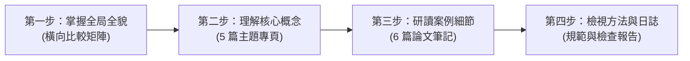
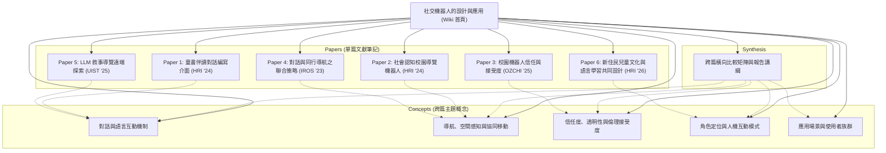

# 社交機器人的設計與應用 (Design and Application of Social Robots)
> 本知識庫為人機互動（HRI）文獻研析、課程報告準備與教學轉譯專用之 LLM Wiki，嚴格奠基於 6 篇頂尖學術論文，並作為後續「教學型 HTML 簡報」之唯一權威知識來源。

---

## 🧭 初學者建議閱讀順序 (Beginner's Reading Path)

如果您是初次接觸社交機器人（Social Robots）領域的學習者，建議依照以下四步驟循序漸進閱讀：

1. **第一步：掌握全局全貌（宏觀維度）**  
   - 先閱讀 **[跨論文橫向比較矩陣與綜合分析](synthesis.md)**：透過大表對比 6 篇論文在場景、角色、模態、評估與限制上的異同，並參考「三軸設計空間圖」建立整體輪廓。
2. **第二步：理解核心概念（主題深探）**  
   依序閱讀 5 篇精簡概念專頁（每篇約 300–500 字，含衝突觀點與原文短句）：
   - 社會接受前提：**[信任度、透明性與倫理接受度](concepts/trust-transparency.md)**
   - 人機權力定位：**[角色定位與人機互動模式](concepts/robot-roles.md)**
   - 語言溝通基石：**[對話與語言互動機制](concepts/dialogue-interaction.md)**
   - 實體空間移動：**[導航、空間感知與協同移動](concepts/navigation-co-navigation.md)**
   - 場域特定考量：**[應用場景與使用者族群](concepts/application-domains.md)**
3. **第三步：深入論文細節（實證案例）**  
   挑選感興趣或報告所需的論文閱讀單篇詳細筆記（具體章節與數據）：
   - 伴讀對話編寫與無形勞動：**[Paper 1 (HRI '24)](papers/paper1-dialogue-authoring.md)**
   - 校園社會意識導航與利害關係人參與：**[Paper 2 (HRI '24)](papers/paper2-campus-guide.md)**
   - 校園半公共空間信任因素與雙重透明度：**[Paper 3 (OZCHI '25)](papers/paper3-campus-robot-trust.md)**
   - DRRL 人機同行移動與對話聯合策略：**[Paper 4 (IROS '23)](papers/paper4-joint-dialog-navigation.md)**
   - 博物館遠端臨場、LLM 敘事與旁觀者效應：**[Paper 5 (UIST '25)](papers/paper5-narrative-remote-guide.md)**
   - 新移民兒童語言文化共學與三方互動：**[Paper 6 (HRI '26)](papers/paper6-codesign-newcomer-learning.md)**
4. **第四步：檢視建置方法與稽核紀錄（工作流與可靠性）**  
   - 查閱規範指南：**[AGENTS.md](../AGENTS.md)**（定義 Ingest、Lint 與簡報生成原則）
   - 查閱維護歷程：**[操作紀錄 (log.md)](log.md)**
   - 查閱數據核驗：**[Lint 檢查報告 (lint-report.md)](lint-report.md)**

---

## 🗺️ 知識地圖 (Knowledge Map)

---

## 📑 知識庫全部頁面清單 (All Pages Directory)

### 一、 總覽與綜合比較 (Overview & Synthesis)
- **[首頁導讀與知識地圖](index.md)**（當前頁面）
- **[跨論文橫向比較矩陣與綜合分析](synthesis.md)**：包含 6 篇論文大表、設計空間地圖與 3 幕式報告講綱。

### 二、 核心主題概念專頁 (Concepts)
- **[對話與語言互動機制 (dialogue-interaction.md)](concepts/dialogue-interaction.md)**：規則斷句、DRRL 狀態追蹤、具身 LLM 與主動發話。
- **[導航、空間感知與協同移動 (navigation-co-navigation.md)](concepts/navigation-co-navigation.md)**：動態扇形 Costmap、同行協同移動、SLAM 最佳觀賞姿態。
- **[信任度、透明性與倫理接受度 (trust-transparency.md)](concepts/trust-transparency.md)**：運作與營運雙重透明度、Hancock 模型擴充、LLM 幻覺信任。
- **[角色定位與人機互動模式 (robot-roles.md)](concepts/robot-roles.md)**：導覽員、工具媒介、同儕伴侶、自我化身與三方互動。
- **[應用場景與使用者族群 (application-domains.md)](concepts/application-domains.md)**：校園、博物館、兒童課輔、房仲等跨場域分析。

### 三、 單篇論文詳細摘要頁 (Papers)
- **[Paper 1: A Robot Dialogue Authoring Interface with Smart Capabilities](papers/paper1-dialogue-authoring.md)**
- **[Paper 2: Development of a Socially Cognizant Robotic Campus Guide](papers/paper2-campus-guide.md)**
- **[Paper 3: Factors of Trust for Successfully Adopting Social Robots on the Campus](papers/paper3-campus-robot-trust.md)**
- **[Paper 4: Learning Joint Policies for Human-Robot Dialog and Co-Navigation](papers/paper4-joint-dialog-navigation.md)**
- **[Paper 5: NarraGuide: an LLM-based Narrative Mobile Robot for Remote Place Exploration](papers/paper5-narrative-remote-guide.md)**
- **[Paper 6: Co-designing a Social Robot for Newcomer Children’s Cultural and Language Learning](papers/paper6-codesign-newcomer-learning.md)**

### 四、 系統治理與檢查日誌 (Meta & Governance)
- **[AGENTS.md](../AGENTS.md)**：LLM Wiki 維護準則、代理人操作手冊與 HTML 簡報生成規範。
- **[操作紀錄 (log.md)](log.md)**：完整 Ingest、Lint、修正與生成歷程。
- **[Lint 檢查報告 (lint-report.md)](lint-report.md)**：單篇出處驗證、數字核對與全局連結健康檢查。
