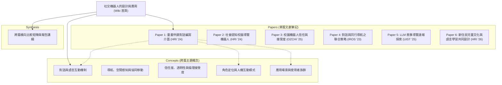

# 社交機器人的設計與應用 (Design and Application of Social Robots)
> 本知識庫為人機互動（HRI）文獻研析與課程報告準備專用之 LLM Wiki，嚴格奠基於 6 篇頂尖學術論文，並作為後續「教學型 HTML 簡報」之唯一權威知識來源。

---

## 🗺️ 知識地圖與導讀指引

本 Wiki 從**系統架構、對話機制、導航控制、信任透明度、互動角色與特定場景**六大維度，全方位解析社交機器人如何走出實驗室並在真實人類社會環境中發揮價值。

---

## 📚 論文筆記索引 (Papers)

| 編號 | 論文標題 | 發表會議/年份 | 核心主題 | 狀態 | 連結 |
| :--- | :--- | :--- | :--- | :--- | :--- |
| **Paper 1** | *A Robot Dialogue Authoring Interface with Smart Capabilities* | HRI '24 Companion | 社交輔助機器人對話編寫介面、NLP 斷句與無形勞動消除 | ✅ 已吸納 | [詳細筆記](papers/paper1-dialogue-authoring.md) |
| **Paper 2** | *Development of a Socially Cognizant Robotic Campus Guide* | HRI '24 Companion | 社會意識校園導覽、動態扇形 Costmap 與跨領域設計 | ✅ 已吸納 | [詳細筆記](papers/paper2-campus-guide.md) |
| **Paper 3** | *Factors of Trust for Successfully Adopting Social Robots on the Campus* | OZCHI '25 | 校園 Pepper 機器人、運作與營運者透明度、信任因素 | ✅ 已吸納 | [詳細筆記](papers/paper3-campus-robot-trust.md) |
| **Paper 4** | *Learning Joint Policies for Human-Robot Dialog and Co-Navigation* | IROS 2023 | 深度循環強化學習（DRRL）、對話與協同導航聯合策略 | ✅ 已吸納 | [詳細筆記](papers/paper4-joint-dialog-navigation.md) |
| **Paper 5** | *NarraGuide: an LLM-based Narrative Mobile Robot for Remote Place Exploration* | UIST '25 | 博物館遠端臨場、LLM 空間敘事引導、旁觀者效應 | ✅ 已吸納 | [詳細筆記](papers/paper5-narrative-remote-guide.md) |
| **Paper 6** | *Co-designing a Social Robot for Newcomer Children’s Cultural and Language Learning* | HRI Companion '26 | 新移民兒童同儕機器人 Maple、第二語言與文化共學、三方互動 | ✅ 已吸納 | [詳細筆記](papers/paper6-codesign-newcomer-learning.md) |

---

## 💡 核心主題概念頁 (Concepts)

1. **[對話與語言互動機制](concepts/dialogue-interaction.md)**  
   探討從早期範本／規則斷句、強化學習聯合決策（DRRL）到大語言模型（LLM）驅動的動態敘事對話機制演進。
2. **[導航、空間感知與協同移動](concepts/navigation-co-navigation.md)**  
   探討從避障導航（Social Costmap）、同行對話（Co-Navigation）到遠端自主空間探索的空間移動策略。
3. **[信任度、透明性與倫理接受度](concepts/trust-transparency.md)**  
   探討運作透明度（Operational Transparency）、營運者透明度（Operator Transparency）、隱私及旁觀者（Bystanders）的社會接受度挑戰。
4. **[角色定位與人機互動模式](concepts/robot-roles.md)**  
   分析導覽員、工具／媒介、同儕夥伴（Peer）、個人化身（Proxy）以及「導師–學童–機器人」三方互動模式。
5. **[應用場景與使用者族群](concepts/application-domains.md)**  
   分析校園導覽、博物館遠端觀光、幼兒陪伴共讀、新住民語文培力等場景的特定需求與設計限制。

---

## 📊 橫向比較與整合分析 (Synthesis)
- **[跨論文橫向比較矩陣與課堂報告指引](synthesis.md)** *(待 6 篇論文全數吸納後生成)*
