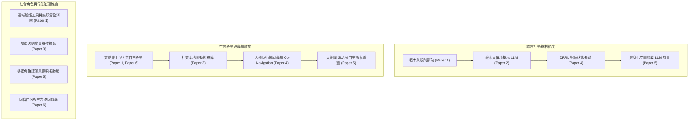

# 跨論文橫向比較矩陣與綜合分析 (Synthesis & Comparison)

本頁面橫向整合 `raw/` 內 6 篇頂尖 HRI 論文，從**應用場景、機器人角色、互動方式、評估方法、主要發現與研究限制**六大維度建立全景比較矩陣，並提供社交機器人設計空間視覺化架構與課堂報告講綱建議。

---

## 1. 跨篇多維度橫向比較矩陣 (Comparison Matrix)

> 註：依據 `AGENTS.md` 規範，表格中每一格均嚴格標註論文出處與具體章節。

| 論文編號與標題 | 應用場景 (Scenario) | 機器人角色 (Role) | 互動方式 (Interaction Modality) | 評估方法 (Evaluation Method) | 主要發現 (Key Findings) | 研究限制 (Limitations) |
| :--- | :--- | :--- | :--- | :--- | :--- | :--- |
| **[Paper 1](papers/paper1-dialogue-authoring.md)** *A Robot Dialogue Authoring Interface...* | 兒童童書伴讀與照護者內容編寫 `[paper1.pdf, Section 1, Section 2]` | 遠端遙控之社交輔助夥伴（SAR）`[paper1.pdf, Section 1]` | 單一文字框輸入、NLP 斷句、自動補全破冰/問答反饋、按鈕預覽 `[paper1.pdf, Section 2.1–2.4]` | 系統雛形與作者實作使用經驗，尚未進行正式量化受試者實驗 `[paper1.pdf, Section 3.2, 4.1]` | NLP 斷句能使機器人發話單元精簡以利遙控節奏 `[paper1.pdf, Section 2.2.2]`；按鈕預覽有助彌合編寫者與遙控者的心智模型差距 `[paper1.pdf, Section 2.4.2]` | 缺乏跨平台通用對話格式 `[paper1.pdf, Section 3.1]`；目前自動生成為語境無關的隨機選取 `[paper1.pdf, Section 4.2]` |
| **[Paper 2](papers/paper2-campus-guide.md)** *Development of a Socially Cognizant Robotic Campus Guide* | 大學校園導覽，協助新生尋找教室 `[paper2.pdf, 1 INTRODUCTION, 2.2]` | 校園自主導航與語音指引導覽員 `[paper2.pdf, 1, 3 SYSTEM OVERVIEW]` | 麥克風分貝觸發語音（GPT 文本生成）與觸控螢幕雙模態 `[paper2.pdf, 3, 4 SPEECH MODULE]` | 室內感測器比較、5 次靜態避障、5 次動態模擬與 9 次端到端導航測試 `[paper2.pdf, 7 EVALUATION AND RESULTS]` | 4.4 米內相機與 LIDAR 效能相當 `[paper2.pdf, 7]`；動態扇形 Costmap 能適應行人轉向不確定性；9 次端到端測試全數成功（*"reliable on each of the nine trials"*）`[paper2.pdf, 7]` | 視覺偵測目前無法計算行人即時速度 `[paper2.pdf, 6, 8]`；語音對非美式口音辨識較弱 `[paper2.pdf, 7]`；尚未評估社會接受度 `[paper2.pdf, 8]` |
| **[Paper 3](papers/paper3-campus-robot-trust.md)** *Factors of Trust for Successfully Adopting Social Robots...* | 大學校園半公共空間多利害關係人環境 `[paper3.pdf, 1, 3.1]` | 校園多功能服務機器人（包含導覽、助理、安防、娛樂等 7 類）`[paper3.pdf, 4.3.1]` | 實體展示（Pepper 人形平台、凝視追蹤、觸控、胸前平板、語音）`[paper3.pdf, 3 Study Design]` | 混合研究法：59 名師生（44 份問卷 + 17 場 60 分鐘深度訪談，2 名重疊）`[paper3.pdf, 3.2–3.4, 4.1]` | 確立「運作透明度」與「營運者透明度」為校園信任核心 `[paper3.pdf, 4.2.1, 5.2]`；擴充 Hancock 信任模型並建議將透明度與安全列為第 8 特徵 `[paper3.pdf, 4.2.4]` | 受試者年輕學生與具科技背景者比例偏高 `[paper3.pdf, 6]`；訪談樣本（17人）限制了跨文化泛化性 `[paper3.pdf, 6]` |
| **[Paper 4](papers/paper4-joint-dialog-navigation.md)** *Learning Joint Policies for Human-Robot Dialog and Co-Navigation* | 房地產看屋導覽，邊走邊介紹房間特徵 `[paper4.pdf, I. INTRODUCTION, IV.A]` | 房仲導覽員（需具備主動引導與說明能力）`[paper4.pdf, I. INTRODUCTION]` | 語意四元組動作空間（對話告知/引導 vs 導航移動/停留）`[paper4.pdf, IV.B, VI.A]` | 模擬環境（10 房屋實例、噪聲注入、500 萬步訓練、100 次運行評估）及 Segway 實體機展示 `[paper4.pdf, VI.A–D]` | 深度循環強化學習（RecurrentPPO）聯合策略在完成率（約 95%）、步數（約 28 步）與共處率（接近 0.98）全面優於基線 `[paper4.pdf, VI.C]` | 強化學習樣本效率低，限制特徵槽位規模 `[paper4.pdf, VII]`；視覺、語言理解與策略未端到端整合 `[paper4.pdf, VII]` |
| **[Paper 5](papers/paper5-narrative-remote-guide.md)** *NarraGuide: an LLM-based Narrative Mobile Robot...* | 地質博物館遠端沉浸式參觀 `[paper5.pdf, 1, 3.4]` | 導覽員、學習工具、同儕伴侶、遠端自我化身（眼睛/Proxy）`[paper5.pdf, 5.2.1–5.2.4]` | 語音對話（GPT-4 意圖分類與 45 秒靜默主動提問）、視訊串流、高低階移動指令 `[paper5.pdf, 3.3.1, 3.3.3]` | 20 名受試者（8 女 12 男）實地 20 分鐘遠端探索、對話日誌分析與事後訪談 `[paper5.pdf, 4.1–4.3]` | 受試者顯著傾向接受推薦（p=0.0007）`[paper5.pdf, 5.1]`；主動提問激發好奇心 `[paper5.pdf, 5.3.3]`；路人互動呈現雙面刃效應 `[paper5.pdf, 5.4.1–5.4.3]` | 嘈雜環境干擾語音辨識 `[paper5.pdf, 6.2]`；LLM 偶有幻覺且非專業者無法察覺 `[paper5.pdf, 5.3.3, 6.2]`；僅諮詢單一地質專家 `[paper5.pdf, 6.2]` |
| **[Paper 6](papers/paper6-codesign-newcomer-learning.md)** *Co-designing a Social Robot for Newcomer Children’s...* | 社區課輔計畫，針對抵達 5 年內之新移民兒童 `[paper6.pdf, 1, 3.1]` | 非威權的平易同儕伴侶（Peer-like companion）、注意力負載平衡器 `[paper6.pdf, 3.3, 4]` | 多模態鷹架（上半身手勢、頭部動畫表情、React 平板雙語故事、角色扮演）`[paper6.pdf, 2.2, 3.4.1–3.4.3]` | 專家共同設計研究（4 位參與者：2 位資深 L2 導師 + 2 位 HRI 研究者，60 分鐘線上工作坊）`[paper6.pdf, 2.1, 2.3]` | 識別出語言、專注力、基準缺乏與師資不足四大瓶頸 `[paper6.pdf, 3.1]`；確立「導師–學童–機器人」三方互動架構與 5 項設計準則 `[paper6.pdf, 3.3, 3.4]` | 成果奠基於專家視角，兒童長程實地個案評估（約 4 名學童）尚在規劃中 `[paper6.pdf, 4 Discussion and Future Work]` |

---

## 2. 社交機器人設計空間視覺化 (Design Space Mapping)

這 6 篇文獻在「**實體空間自主度（Spatial Mobility & Autonomy）**」、「**語言互動複雜度（Dialogue & Semantic Intelligence）**」與「**社會情境敏感度（Social & Ethical Context Sensitivity）**」三軸上展現了豐富的光譜分佈：

---

## 3. 課堂報告核心亮點與講綱建議 (Presentation Guide)

若需進行 10~15 分鐘的課程簡報或專題研討，建議可依據本知識庫採取以下三幕式講綱架構：

### 第一幕：破題 — 社交機器人為何難以走出實驗室？（約 3 分鐘）
- **核心痛點**：內容創作的「無形勞動」（[Paper 1](papers/paper1-dialogue-authoring.md)）與半公共環境中的「透明度與信任缺失」（[Paper 3](papers/paper3-campus-robot-trust.md)）。
- **關鍵論點**：機器人走入社會，瓶頸往往不在機械運動本身，而在於非技術人員如何輕鬆賦予機器人內容，以及大眾是否清楚「背後是誰在營運、資料被如何使用」。

### 第二幕：技術核心 — 移動與對話如何交織？（約 6 分鐘）
- **動態空間避障**：如何從「反社交」的幾何避障進化為考慮轉向不確定性的動態扇形 Costmap（[Paper 2](papers/paper2-campus-guide.md)）。
- **邊走邊說的智慧**：人機同行時非共處（Not co-located）的挑戰，以及 DRRL 如何讓機器人學會「走到身邊再開口說話」（[Paper 4](papers/paper4-joint-dialog-navigation.md)）。
- **具身大語言模型**：LLM 結合空間語義地圖的主動提問導覽，以及伴隨而來的「幻覺盲目信任」倫理挑戰（[Paper 5](papers/paper5-narrative-remote-guide.md)）。

### 第三幕：未來想像 — 重塑人機社會關係（約 4 分鐘）
- **顛覆二元人機關係**：從「人對機器」轉變為「導師–學童–機器人」三方共生互動（[Paper 6](papers/paper6-codesign-newcomer-learning.md)），將機器人定位為輔助同儕而非威權導師。
- **旁觀者效應**：公共空間中路人、孩童與遠端操作者之間的微妙動態（[Paper 5](papers/paper5-narrative-remote-guide.md)）。
- **總結展望**：未來的社交機器人必須是「運作與營運雙重透明」、「空間與語意同步感知」、且「具備文化與情境包容力」的複合體。

---

## 4. 相關概念頁面索引 (Related Concepts)
- [對話與語言互動機制](concepts/dialogue-interaction.md)
- [導航、空間感知與協同移動](concepts/navigation-co-navigation.md)
- [信任度、透明性與倫理接受度](concepts/trust-transparency.md)
- [角色定位與人機互動模式](concepts/robot-roles.md)
- [應用場景與使用者族群](concepts/application-domains.md)
